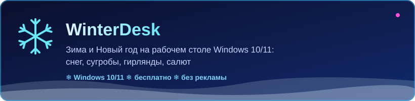

### Разработчик ботов, сайтов и приложений для Windows

 

## 🧊 Технологии

## 📊 Статистика

 

## ❄️ Проекты

<table>
<tr><td>🤖 <b>Боты для Discord и Telegram</b></td><td>Antwoord AI, 5stack-bot, BotHouse</td></tr>
<tr><td>🏠 <b>Antwoord FamQ</b></td><td>Семейный сайт с входом через Discord</td></tr>
<tr><td>🏛️ <b>Госструктуры RP-серверов</b></td><td>Боты и системы: Government, MinFin Nova, EMS Eclipse</td></tr>
</table>

Эти проекты закрытые, код не публикуется.

## 🐍 Змейка активности

<picture>
  <source media="(prefers-color-scheme: dark)" srcset="https://raw.githubusercontent.com/NikoliniOFF/NikoliniOFF/output/github-snake-dark.svg"/>
  <source media="(prefers-color-scheme: light)" srcset="https://raw.githubusercontent.com/NikoliniOFF/NikoliniOFF/output/github-snake.svg"/>
  
</picture>

